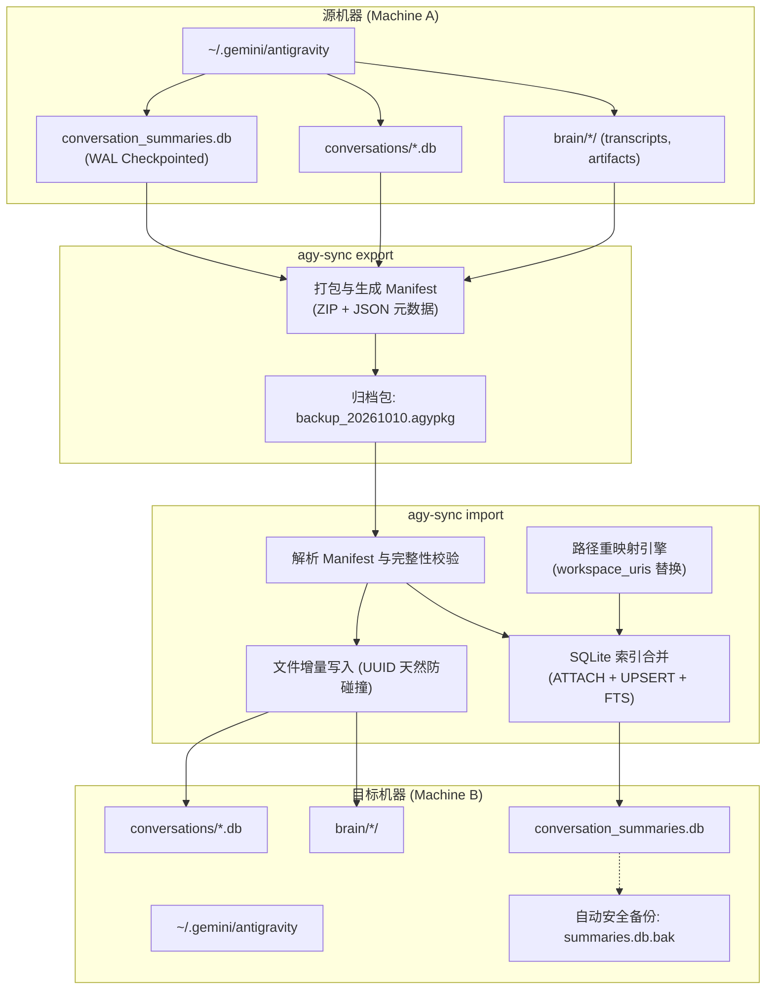

# Antigravity 会话跨机同步与迁移工具 (agy-sync) 设计方案

本方案旨在为独立运行的 **Antigravity CLI / 核心运行时** 提供一套轻量、稳定、免外部依赖的会话历史跨机导出、迁移与增量合并工具。

---

## 1. 核心设计原则

1. **Zero External Dependencies**：基于纯 Python 3.8+ 标准库（`sqlite3`、`zipfile`、`argparse`、`shutil`、`pathlib`），开箱即用，无需 `pip install`。
2. **Runtime Independence**：不依赖 IDE 宿主，直接面向文件系统与 SQLite 数据库层，同时具备进程检测与 WAL 安全快照机制。
3. **Non-Destructive by Default**：导入时默认采用增量合并（`merge`），自动备份目标机现有数据，绝不覆盖设备指纹（`installation_id`）。
4. **Cross-Platform Friendly**：支持 Windows、macOS 与 Linux 间自由互转，提供工作区路径重映射能力。

---

## 2. 系统需求规格 (Requirements)

### 2.1 功能性需求 (FR)

- **FR-1 [导出 Export]**：
  - 支持将指定机器上的全量或条件过滤后的会话打包为单个归档文件（`.agypkg`，标准 zip 格式）。
  - 支持按时间范围（`--since`）、工作区关键词（`--workspace`）或会话 ID 列表进行增量/定向导出。
  - 支持选择是否包含大体积临时文件（`scratch/`、`.tempmediaStorage`）。
- **FR-2 [导入与合并 Import]**：
  - **增量合并模式 (`--mode merge`)**：保留目标机原有会话，仅注入不存在或更新的会话及对应的 SQLite 摘要/全文索引。
  - **覆盖模式 (`--mode overwrite`)**：全量覆盖会话与索引库，覆盖前强制生成快照备份。
  - **工作区路径重映射 (`--remap-workspace`)**：自动将摘要库中的旧机器路径替换为目标机当前路径。
  - **安全防线**：忽略并严禁覆盖目标机的 `installation_id` 与 `antigravity_state.pbtxt`。
- **FR-3 [探查与校验 Inspect]**：
  - 支持免解压快速检查归档包内包含的会话列表、数据量、生成时间、源系统版本及工作区列表。
  - 导入前校验归档完整性（SHA256 校验与 SQLite 文件完整性检查）。
- **FR-4 [列表与诊断 List / Doctor]**：
  - 列出本机或归档包内的会话摘要（ID、标题、步数、更新时间、绑定工作区）。
  - 检测本机 Antigravity 数据目录健康状况（孤立 `.db` 文件检测、索引损坏检测）。

### 2.2 非功能性需求 (NFR)

- **NFR-1 (数据一致性)**：导出前检测 SQLite WAL 状态并执行安全 Checkpoint，避免导出未提交的内存脏页。
- **NFR-2 (原子性与可回滚)**：导入过程中若发生任何错误（如磁盘满、SQL 异常），自动触发全量回滚，恢复到导入前的快照状态。
- **NFR-3 (传输效率)**：采用标准 Deflate/Zstandard 算法，将数 GB 的会话数据压缩至数百 MB。

---

## 3. 架构与数据流设计 (Architecture)

### 3.1 迁移数据流图



### 3.2 归档包结构规范 (`.agypkg`)

```text
backup_20261010.agypkg (ZIP Archive)
├── manifest.json                  # 元数据：版本、平台、会话清单、SHA256
├── conversation_summaries.db      # 导出的摘要切片库 (含 FTS5 全文表)
├── conversations/                 # 会话轨迹 SQLite 实体
│   ├── 00476170-...db
│   └── 031ce632-...db
└── brain/                         # 真实交互转录与生成物
    ├── 00476170-.../
    │   ├── .system_generated/logs/transcript.jsonl
    │   └── *.md (artifacts)
    └── 031ce632-.../
```

---

## 4. CLI 命令行接口规范

统一入口命令：`agy-sync`

### 4.1 `agy-sync export` (导出会话)

```bash
# 1. 全量导出所有会话到默认包名
agy-sync export

# 2. 指定输出路径并过滤最近 30 天内的会话
agy-sync export -o ~/backup.agypkg --since 2026-09-10

# 3. 仅导出指定工作区的会话，排除大体积 scratch 临时目录
agy-sync export --workspace "CascadeProjects/swissql" --no-scratch

# 参数说明：
#  -o, --output PATH         输出归档包路径 (默认: agy_backup_<timestamp>.agypkg)
#  --since YYYY-MM-DD        只导出指定日期之后的会话
#  --workspace KEYWORD       只导出匹配该工作区路径的会话
#  --no-scratch              排除 brain/ 下的 scratch/ 临时文件
#  --force                   若 Antigravity 正在运行，跳过警告强制导出
```

### 4.2 `agy-sync import` (导入与合并)

```bash
# 1. 默认增量合并导入，自动进行工作区路径替换
agy-sync import ~/backup.agypkg --remap-workspace "C:/Users/alice=D:/Users/bob"

# 2. 演练模式（只打印待导入会话与冲突情况，不落盘）
agy-sync import ~/backup.agypkg --dry-run

# 3. 覆盖模式（警告：会替换目标机全部会话，但会自动创建本地快照备份）
agy-sync import ~/backup.agypkg --mode overwrite

# 参数说明：
#  BUNDLE_PATH               待导入的 .agypkg 包路径 (必填)
#  --mode [merge|overwrite]  导入策略: merge (增量合入，默认), overwrite (全量替换)
#  --remap-workspace OLD=NEW 批量替换工作区根路径 (可多次指定)
#  --dry-run                 仅校验并打印导入计划，不写入磁盘
#  --no-backup               跳过导入前的自动备份 (不推荐)
```

### 4.3 `agy-sync inspect` (探查归档或本机)

```bash
# 查看导出的压缩包概况
agy-sync inspect ~/backup.agypkg

# 查看本机当前的 Antigravity 存储健康状态
agy-sync inspect --local
```

### 4.4 `agy-sync list` (列出会话)

```bash
# 列出本机所有会话详情
agy-sync list

# 列出压缩包内包含的会话详情
agy-sync list -f ~/backup.agypkg
```

---

## 5. 核心底层技术机制

### 5.1 SQLite WAL 安全快照机制
在导出时，若检测到 `conversation_summaries.db-wal` 存在且包含未提交事务：
1. 尝试以只读模式连接并执行 `PRAGMA wal_checkpoint(PASSIVE)` 或 `TRUNCATE`；
2. 若无法获取锁，使用 Python `sqlite3.backup` API 将其安全流式复制到临时一致性快照文件中，彻底消除脏读与锁冲突。

### 5.2 索引与全文检索（FTS5）增量合并逻辑
导入时利用 SQLite 内置的 `ATTACH` 机制，在单一事务中实现原子合并：
```sql
BEGIN TRANSACTION;

-- 1. 附加导入包中的摘要数据库
ATTACH DATABASE '{source_db_path}' AS src;

-- 2. 增量更新会话元数据（主键为 conversation_id）
INSERT INTO conversation_summaries
SELECT * FROM src.conversation_summaries
WHERE true
ON CONFLICT(conversation_id) DO UPDATE SET
    title = excluded.title,
    preview = excluded.preview,
    step_count = excluded.step_count,
    last_modified_time = excluded.last_modified_time,
    workspace_uris = excluded.workspace_uris,
    status = excluded.status;

-- 3. 增量更新全文检索 FTS5 索引
INSERT INTO conversations_fts (
    conversation_id, chunk_index, chunk_first_step, chunk_last_step,
    last_modified_time, step_count, last_step_created_at, archived,
    user_step_byte_offsets, agent_step_byte_offsets,
    title, workspace, project, user_body, agent_body
)
SELECT 
    conversation_id, chunk_index, chunk_first_step, chunk_last_step,
    last_modified_time, step_count, last_step_created_at, archived,
    user_step_byte_offsets, agent_step_byte_offsets,
    title, workspace, project, user_body, agent_body
FROM src.conversations_fts
WHERE conversation_id NOT IN (SELECT conversation_id FROM conversations_fts);

-- 4. 路径重映射 (若传入参数)
UPDATE conversation_summaries
SET workspace_uris = REPLACE(workspace_uris, '{old_path}', '{new_path}')
WHERE workspace_uris LIKE '%{old_path}%';

COMMIT;
DETACH DATABASE src;
```

---

## 6. 实施步骤规划

1. **第 1 步 (底层引擎封装)**：编写 `storage.py`（跨平台路径定位、安全只读备份、WAL 处理）。
2. **第 2 步 (打包与解包)**：编写 `bundle.py`（ZIP 流式打包、`manifest.json` 构造、校验与解压）。
3. **第 3 步 (数据库合并器)**：编写 `merger.py`（SQLite ATTACH、UPSERT、FTS5 同步、路径重映射）。
4. **第 4 步 (CLI 接口组装)**：编写 `main.py`（基于 `argparse` 的统一命令行接口与优雅日志输出）。
5. **第 5 步 (自测验证)**：在本地当前环境对真实数据执行一次 export ➔ inspect ➔ merge 演练，确保数据无损。
